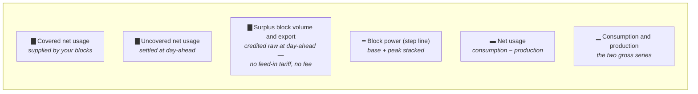

# F03 — Consumption & Production Visualisation

**Portal:** customer · **Priority:** Must · **Phase:** 1 (chart) / 2 (block overlay) · **Size:** L

---

## 1. Summary

The chart is the product's centre of gravity. It answers three questions at a glance: *what did I
use*, *what have I already hedged*, and *where am I exposed*. Everything else — price indications,
the trade request on Prices — hangs off a decision the customer makes while looking at this screen.

Two views: **day** (96 points, the shape of a working day) and **month** (daily totals, the shape of a
season). Purchased blocks overlay both.

> **[DEC-22] changes what the chart is about.** The volume basis is **net usage** = consumption −
> production, per interval per metering point. The chart therefore carries **three** series — the two
> gross ones and the net one — and coverage, the KPI strip and the covered / uncovered / surplus
> rendering are all measured against net usage, not against gross consumption. Consumption and
> production remain separate non-negative series **[AS-05]**; net usage is derived from them.
> Net usage may be **negative** in an interval when production exceeds consumption. That is export,
> and it is credited at the day-ahead price **[DEC-23]** — so the surplus band is now money the
> customer receives, not merely a shape on a chart.

> **What the 2026-08-19 round changed here.** Five decisions touch this screen. None of them changes
> the volume basis: **[DEC-22]** is untouched, net usage stays the basis, and **[DEC-23]** was
> confirmed verbatim in the same round ("over covered is a sell on the day ahead").
>
> | Decision | Effect on the chart |
> | --- | --- |
> | **[DEC-87]** | Exported volume is credited **raw at the day-ahead price**. The second half of **[DEC-44]** — a feed-in tariff with its own line category — is **reversed**. No legend entry, series name, tooltip or KPI on this screen may name a feed-in tariff or a feed-in fee: below the zero line the customer sees the same day-ahead number as above it, with no topup and no fee subtracted |
> | **[DEC-81]** | Customers may **see** prices in the portal but get **no price history and no price export**. Prices stay on screen and come out of every download **[F03-R23]**, **[F03-R26]** |
> | **[DEC-97]** | **Usage** data is the customer's to take away — the CSV here, and a programmatic route whose transport is still open **[OQ-95]**. The split is clean and easy to state: volumes leave, prices do not |
> | **[DEC-79]** | The charting library **may be commercially licensed**; **[DEC-39]** is reversed. The phase-0 spike ranks candidates on fit **[OQ-22]** |
> | **[DEC-68]** | Gas is out of scope, withdrawing **[DEC-30]**. There is **no gas series**, no m³ axis and no commodity switch on this chart |

## 2. User stories

| As a… | I want to… | So that… |
| --- | --- | --- |
| Customer user | see a day's consumption in 15-minute detail | I can see my load shape and my peaks |
| Customer user | see a month at daily resolution | I can see trend and weekday/weekend patterns |
| Customer user | see my purchased blocks drawn on the same chart | I can tell covered from uncovered volume immediately |
| Customer user | compare this period against the previous one | I can see whether something changed |
| Customer user | see consumption, production and net usage together | I can see the volume I am actually covered and charged on |
| Customer user | know whether the data is provisional or final ⚠ **Retired in the customer portal 2026-10-08 by [DEC-176] (4): provisional or final is no longer shown.** | I know how much to trust it |
| Customer user | switch between metering points, or view several combined | I can work per site or per portfolio |
| Customer user | export the underlying **usage** data | I can use it in my own model — prices are not part of the export **[DEC-81]**, **[DEC-97]** |
| Customer user | go from "I'm exposed here" to a trade request in one click | the insight leads somewhere |

## 3. Functional requirements

### Day view

| ID | Requirement | MoSCoW |
| --- | --- | :--: |
| F03-R01 | The day view renders 15-minute interval data for one Amsterdam calendar day: 96 points normally, 92 or 100 on DST transition days. | Must |
| F03-R02 | Consumption, production and **net usage** (consumption − production) are rendered as three distinct, visually separable series **[DEC-22]**. The y-axis accommodates negative net usage; the zero line is always drawn. | Must |
| F03-R03 | The x-axis is local time with hour ticks; the autumn duplicate hour is labelled unambiguously (`02:00 A` / `02:00 B`). | Must |
| F03-R04 | The y-axis is kWh per interval by default, with a toggle to average kW. | Should |
| F03-R05 | Hovering an interval shows a tooltip with: local time range, consumption, production, **net usage**, block cover, net position (net usage − block cover), and the day-ahead price if available **[DEC-22]**. The price is **display-only** — it appears in the tooltip and in no export **[DEC-81]**, **[F03-R26]**. Montel day-ahead history is available for backfill **[DEC-75]**, so "if available" now means a feed gap, not a depth limit on how far back the chart can show a price. ⚠ **Amended 2026-10-13 by [DEC-180] (3), (9): the price is euro per kWh with 5 decimals. The source is ENTSO-E from 2026-01-01 [DEC-172]; "if available" means the day is not stored.** | Must |
| F03-R06 | Missing intervals are drawn as gaps, never as zero **[F02-R25]**. | Must |
| F03-R07 | Date navigation: previous/next day, a date picker, and a jump to the most recent day with data. ⚠ **Amended 2026-10-08 by [DEC-176] (5): the Day view also scrolls and drags into neighbouring days; the shared date picker with Previous and Next stays as the non-drag way; the selected date follows the scroll and the URL.** | Must |

### Month view

| ID | Requirement | MoSCoW |
| --- | --- | :--: |
| F03-R08 | The month view renders daily totals for one calendar month. | Must |
| F03-R09 | Each day is clickable and drills into the day view. | Must |
| F03-R10 | Days with partial or missing data are visually marked, not silently short. ⚠ **Amended 2026-10-08 by [DEC-176] (4): the Final / Partial status pill and the descriptive line are removed from the customer charts; missing connections are still reported by the connection-coverage line of [DEC-147] (*2 of 3 connections reported*).** | Must |
| F03-R11 | Non-peak days are shaded, using the same calendar as the peak definition **[DEC-14]**. Under **[DEC-19]** that is **Saturdays and Sundays only**: peak is Mon–Fri, at or after 08:00 and strictly before 20:00 `Europe/Amsterdam`, and public holidays are **not** excluded, so a holiday on a weekday is shaded as a peak day like any other. If a peak calendar's `excluded_dates[]` is ever populated, those dates shade too — the rule reads the calendar, never a hard-coded holiday list. | Should |
| F03-R12 | A quarter and a year view follow the same pattern at coarser granularity. | Could |

### Block overlay

| ID | Requirement | MoSCoW |
| --- | --- | :--: |
| F03-R13 | Confirmed blocks are overlaid as a step line showing total block power per interval, stacking base and peak **[F05](F05-energy-block-trading.md)**. ⚠ **As built 2026-10-07 by [DEC-175]:** drawn as a dashed, stepped *Hedge volume* line on the Volume page when the company holds Future Trading, from `GET /consumption/position`, CONFIRMED blocks only, account-level (the all-connections view); it is also drawn over future intervals with no usage (*hedge only*). | Must |
| F03-R14 | Coverage bands are drawn against **net usage**, not gross consumption **[DEC-22]**. The area below the overlay and under the net-usage curve is **covered**; net usage above it is **uncovered**; overlay above net usage is **surplus**. Where net usage is negative the whole interval is **export** and is rendered as surplus below the zero line, because it settles the same way **[DEC-23]** — raw at the day-ahead price for the interval, with no feed-in tariff and no topup fee touching it **[DEC-87]**. The band therefore needs no second colour and no second legend entry for export: it is the surplus band, drawn below zero. ⚠ **As built 2026-10-07 by [DEC-175]:** when Future Trading is held the Volume page's bars are **Covered / Uncovered — bought at day-ahead / Surplus — sold at day-ahead** (Dutch *Afgedekt* / *Niet afgedekt* / *Overschot*; the dashed step line is *Block volume*, *Blokvolume*) on the clamped legs of P&C §4 (50-calculations/02-position-and-coverage.md, for `H ≥ 0`), against a solid net-usage line, and they **replace** the consumption/production bars; without the product the page is unchanged. *Short* and *Long* are the formula names of this requirement's uncovered and surplus and are never customer copy; the export-below-zero reading is covered by *Surplus*. | Must |
| F03-R15 | The overlay is derived from the same coverage function used for invoicing, on the same net-usage basis — one implementation, no divergence **[DEC-22]**. ⚠ **As built 2026-10-07 by [DEC-175]:** one shared, database-free pure calculation serves the position read's chart series, table and cost, on net usage. Invoicing is specified, not built; the Dashboard position remains the recorded gross exception. | Must |
| F03-R16 | Accepted-but-unconfirmed trades can be shown as a separate, visually provisional overlay, off by default and clearly labelled. ⚠ **Not built 2026-10-07 ([DEC-175] D1):** only CONFIRMED trades count; accepted-but-unconfirmed trades are not overlaid. | Should |
| F03-R17 | A legend lists the contributing blocks, each linking to its trade detail. ⚠ **Partly built 2026-10-07 ([DEC-175] (3)):** the position read returns the contributing blocks (reference, shape, period, ~~MW, price~~ kW, price in €/kWh ⚠ **Amended 2026-10-13 by [DEC-180] (10).**); a legend that links each to its trade detail is not part of this build. | Must |
| F03-R18 | Individual blocks can be toggled to see the effect of removing one. ⚠ **Not built 2026-10-07 ([DEC-175]).** | Could |

### Metrics and interaction

| ID | Requirement | MoSCoW |
| --- | --- | :--: |
| F03-R19 | A KPI strip above the chart shows, for the visible range: total consumption, total production, **total net usage**, block volume, covered %, ~~uncovered MWh, surplus MWh~~ uncovered kWh, surplus kWh (⚠ **Amended 2026-10-13 by [DEC-180] (11).**), and the indicative day-ahead value of the open position **[DEC-22]**. That last figure is signed: a cost when the position is short, a **credit** when it is long, because surplus is credited at day-ahead **[DEC-23]**, raw and without a feed-in fee **[DEC-87]**. Cost and credit are shown as two figures, never as one net number. Both figures are computed and displayed; neither is exportable, because both are prices multiplied by volumes **[DEC-81]**, **[F03-R26]**. ⚠ **Partly built 2026-10-07 by [DEC-175] (3)–(6):** a position panel shows the actual cost with hedge cost, bought at day-ahead and the day-ahead credit as three separate figures (never netted), a Covered / Uncovered / Surplus bar with kWh and coverage % (Σ covered ÷ Σ max(net usage, 0) over metered intervals, *—* when that is 0, per P&C §4 and business rule 3; the hedge ratio is deliberately not shown, a departure from P&C §4's "both, or the hedge ratio alone"), labelled *ex VAT and energy tax*; the hedge cost contracted for the whole range is a separate figure. Total consumption, production and hedge ratio tiles are not part of this build. | Must |
| F03-R20 | Every KPI carries the data state of its range; a range containing non-final data is labelled *provisional*. ⚠ **Amended 2026-10-08 by [DEC-176] (4): provisional marking is removed completely in the customer portal; the requirement is withdrawn there.** | Must |
| F03-R21 | A metering point selector supports one, several, or all — with several rendering the aggregate. | Must |
| F03-R22 | Comparison mode overlays the previous equivalent period (previous day / same weekday last week / previous month / same month last year). | Should |
| F03-R23 | ⚠ **Amended 2026-08-19 by [DEC-81]**. Original, kept readable: *"The visible data can be exported as CSV and as PNG. Montel **price-indication** series are excluded from the export until the licence permits redistribution **[F04-R16]**, **[DEC-27]**."* The visible **usage** data can still be exported as CSV and as PNG — that half is now backed by **[DEC-97]**, which puts the customer's own usage data explicitly in their hands. What changed is the word *until*: price data is excluded **permanently**, not pending a licence reading. The CSV carries interval/day timestamps, consumption, production, net usage, block cover and coverage state, and **no price column of any kind** — day-ahead included **[F03-R26]**. **[F04-R16]** stays as written and is now backed by a decision instead of by an unread licence. | Should |
| F03-R24 | ⚠ **Superseded 2026-10-09 by [DEC-178]: the web never built this action and the trade wizard it opened is removed; a request is made from the Prices request panel.** A **"Hedge this exposure"** action on the chart opens the trade wizard pre-filled with the visible period and the **uncovered net-usage** volume as a suggested MW **[DEC-22]**. When the visible range has no uncovered volume — including a range that is net long or net exporting — the action is disabled with a plain explanation rather than offering a hedge against a surplus. | Should |
| F03-R25 | The chart is usable on a tablet: pinch-zoom on the x-axis, tap for tooltip. Phone gets a simplified view. ⚠ **Amended 2026-10-02 by [DEC-173]: charts switch to a narrow mode below 1024 px, keyed on the viewport and not on card width, and stay legible from a 343 px column; the month chart's day columns are about 9 px at 375, a recorded follow-up.** | Should |
| F03-R26 | **No price data leaves this screen.** No CSV column, no PNG that renders a price series, no download, and no endpoint offered for programmatic or bulk consumption carries a day-ahead price, a forward indication, or a €-value derived from one **[DEC-81]**, **[DEC-97]**. Prices stay *visible*: the tooltip **[F03-R05]**, the exposure KPI **[F03-R19]** and the optional secondary price axis **[F04-R13]** are unaffected, and the portal's own chart endpoint still returns the interval price it needs to draw them — that is rendering, not redistribution — but that endpoint is not documented, published or opened for customer use, and the customer usage API **[DEC-97]** carries volumes only. ⚠ **Applied 2026-10-07 by [DEC-175] (3), (6):** `GET /consumption/position` is such a portal chart endpoint; its euro figures are display-only, and the interval table's CSV gains hedge, covered, short and long **kWh** columns and no euro column. If the secondary axis is built, PNG export renders the chart without it. ⚠ **Reading recorded rather than assumed:** **[DEC-81]**'s source says "no history", and this screen shows the day-ahead price of a past interval. The price of an interval the customer is *charged on* is treated as part of that interval's settlement and stays in the tooltip; what is excluded is a price-history **product** — a price-over-time chart, a price series export, a price API. Confirm at the next session if the intent was stricter. | Must |
| F03-R27 | The chart CSV and the customer usage API **[DEC-97]** serve the **same net-usage figures from the same rollups** as the chart itself — one implementation, for the same reason **[F03-R15]** gives for coverage. A customer who exports and a customer who calls the API must not be able to derive two different numbers for one interval. The transport of the programmatic route is **[OQ-95]** and does not change this requirement. | Must |
| F03-R28 | ⚠ **New 2026-10-13 by [DEC-180] (4).** The cost of usage is **saved, one per connection per quarter-hour**: net usage in kWh × the day-ahead price in €/kWh, rounded to 5 decimals, half away from zero. No usage or no price: no saved cost, and the chart draws a gap. A cost of zero is a saved `0.00000` and a bar. The plain cost chart of the Volume page, the cost chart of the connection detail page and every cost total read the saved values: no read multiplies, and none falls back to multiplying. A cost is served only when it was made from the usage and the price shown beside it; the cost of a selection is the sum of its connections' saved costs. | Must |
| F03-R29 | ⚠ **New 2026-10-13 by [DEC-180] (5).** The position is **saved, one per customer per quarter-hour**: metered usage, hedge energy, covered, short and long (kWh), hedge cost, bought, sold, actual cost and cost without hedge (euro, 5 decimals). The position chart and panel read the saved rows. Hedge cost + bought − sold = actual cost holds exactly on every quarter-hour and on every total. | Must |
| F03-R30 | ⚠ **New 2026-10-13 by [DEC-180] (8).** An open Volume page or connection detail page reads a day again, on a timer, while it has a measured quarter-hour without a cost, and reads the position again while fewer quarter-hours are costed than measured, and also a recent position day with nothing metered at all (a day not yet recalculated reads as not metered). The plain cost chart says when its total covers only part of the period: it counts the measured and the costed quarter-hours of the period it totals from the intervals of the answer, by the server's own definition; `meteredIntervals` and `costedIntervals` on the summary carry the same two counts for the window that was asked. The sentence names no cause. No notice says that a cost changed. The schedule is the one of [DEC-180] (8): a tick every 30 seconds while the tab is visible; a waiting cost every 30 seconds six times, then every 5 minutes; a day without a price or without a saved position every 5 minutes and only from today minus 7 days to today. The wording of the sentence is the web's and is not quoted here. | Must |

## 4. Business rules

1. ⚠ **One coverage implementation** (exception: the Dashboard position summary is a second, gross-consumption calculation, [DEC-167] (19)). Chart, invoice and employee view call the same function. A
   discrepancy between the chart and the invoice destroys trust faster than any bug.
2. **Provisional data is always labelled.** No number derived from non-final data appears without its
   state. ⚠ **Amended 2026-10-08 by [DEC-176] (4): no longer applies in the customer portal; the state is not shown.**
3. ⚠ **Aggregation across metering points sums volumes; it never averages prices or ratios.** (Exception: the Dashboard summary divides by gross consumption, not net usage, [DEC-167] (19).)
   Coverage ratio for a selection is `Σ covered / Σ net usage` **[DEC-22]**, aggregated first and
   divided second. Intervals with negative net usage contribute nothing to the denominator: they are
   export **[DEC-23]**, reported as their own figure. Netting them into the denominator would make
   the ratio uninterpretable.
4. ⚠ **Amended 2026-10-07 by [DEC-175] (1) D6, on [DEC-167] (16):** the overlay is **account-level**. A block has one volume and no per-connection split, so the hedge is drawn on the all-connections view only; with a single-connection filter and on a connection's detail page no hedge is drawn, and **only when the company holds `future-trading`** a note says hedges apply to the whole company; without Future Trading those views are exactly as today, with no note. Original, kept readable: *The overlay reflects allocation, not the whole block. If a 1 MW block is allocated 0.2 MW to
   this metering point, the overlay shows 0.2 MW here.*
5. **Local time throughout.** No UTC anywhere in a customer-facing chart.
6. **Empty state is informative.** "No data yet — first data for a day arrives the following day"
   beats a blank canvas.
7. **Volumes leave the platform; prices do not.** Everything a customer can take away from this
   screen is a volume, a coverage figure or a block quantity **[DEC-97]**. Prices are rendered and
   never redistributed **[DEC-81]**, and that applies to day-ahead prices as well as to forward
   indications, because both are Montel-derived **[DEC-36]**, **[DEC-75]**. ⚠ **Amended 2026-10-13 by [DEC-180]: the day-ahead curve is ENTSO-E data with its own CSV export since [DEC-169]; no cost in euro leaves the screen.** The cost of the rule is
   real: a customer who wants to reconcile a day-ahead amount in a spreadsheet has to read the price
   off the tooltip or wait for the invoice.
8. **Export settles like surplus, at one price.** There is no second export price on this chart. The
   feed-in tariff **[DEC-44]** is withdrawn **[DEC-87]**; below-zero volume is credited at the same
   day-ahead price the uncovered band is charged at, so the two sides of the zero line are directly
   comparable.

## 5. Reading the chart

The bands are drawn against **net usage**; the two gross series stay on the chart so the customer can
see where the net figure came from **[DEC-22]**. Below the zero line the surplus band is export, which
is credited at day-ahead rather than merely displayed **[DEC-23]** — **raw**, at the same price as the
band above the line, because **[DEC-87]** withdraws the feed-in tariff that **[DEC-44]** had put there.
That is why the legend has one crediting entry and not two: an earlier draft of this chart would have
needed a separate export colour and an "at the feed-in tariff" caption, and it no longer does.

There is **no gas series and no commodity switch** on this chart. Gas is out of scope **[DEC-68]**,
which withdraws **[DEC-30]**, so every axis, legend entry and total on this screen is electricity in
kWh ~~or MWh~~ (⚠ **Amended 2026-10-13 by [DEC-180] (11): kWh only.**). The `commodity` discriminator still exists in the model **[DEC-15]**, so a gas series is
an addition later rather than a rebuild — but nothing on this screen renders one today.

The 08:00 and 20:00 steps in the block line on weekdays are the single most informative feature of
the chart — they show peak cover starting and stopping. On **every** Monday to Friday, public
holidays included **[DEC-19]**. The design must not smooth them.

> **As built 2026-10-01 by [DEC-169] (6) — the Dashboard leads with a day-ahead prices card.** The hero is **removed for every account** and its reads with it; the page keeps exactly one `h1`. The new first card, **Day-ahead prices**, shows *{Weekday, d MMM yyyy} · Netherlands · ~~€/MWh~~*, a **Yesterday / Today / Tomorrow** control and a date input bounded by `availableFrom`..`availableTo` (a date that matches none of the three clears the segment), and an **hourly bar chart** of 23, 24 or 25 bars: the **three cheapest hours are green, the three most expensive red** (ties to the earlier hour, a legend says so) ⚠ **[Amended 2026-10-02 by DEC-172 (6): the chart is per quarter-hour — 92, 96 or 100 bars from `quarters[]`, the 12 cheapest green and the 12 most expensive red, each with a small ▼ or ▲ triangle, the X axis labelled 00 to 21 every three hours, and times such as *13:15–13:30*; Lowest and Highest are the quarters', and the Average is the API's whole-day average]**, the rest neutral, negative prices below a zero line; every bar has an accessible name (*13:00–14:00, ~~€ 87,20 per MWh~~, cheapest*), a tooltip on hover and focus, and a visually hidden table carries the same data. A row gives Average, Lowest and Highest. An unpublished day reads *Prices for {date} are published around 13:00 the day before*, and a day before `availableFrom` says no data exists for that date. The source line reads *Source: ENTSO-E Transparency Platform*, or *Source: EPEX Spot (demo data)* for seed rows ⚠ **[DEC-172: the seed is removed and the line is always the ENTSO-E one]**. **Download CSV** offers *This day (15-minute)* and *Date range…* (From, To and Hourly or 15-minute, the latter capped at 366 days). The KPI row below stays for a Future Trading account. ⚠ **Amended 2026-10-08 by [DEC-176] (2, 3): the KPI row is removed; the Average / Lowest / Highest row and the Yesterday / Today / Tomorrow control are removed; the chart is a draggable window over yesterday, today and tomorrow with a Y scale, a current-quarter marker, the shared date picker, per-day cheapest / dearest ranking and a small ENTSO-E source footnote; the hidden table covers the loaded days.** The mockup [`customer-dashboard.svg`](../60-mockups/customer-dashboard.svg) is not redrawn (it has no day-ahead chart to redraw). ⚠ **Amended 2026-10-13 by [DEC-180] (9): the card, its chart, its tooltip and its hidden table show euro per kWh with exactly 5 decimals (€ 0,08720 per kWh); the CSV column is price_eur_per_kwh.**
>
> ⚠ **Removed 2026-10-13 by [DEC-180] (11): the route and its DTO are deleted; no screen read them since [DEC-176] (2). The text below is kept as the record of what it calculated.** **As built 2026-10-01, the monthly position ([DEC-167] (19)).** The customer Dashboard shows a month's position from `GET /api/v1/dashboard/position?month=YYYY-MM` (default: the current Amsterdam month; any member; tenant-scoped). It is a **separate DTO** from the consumption ones, so [DEC-149] stands: the consumption DTOs carry no block fields. The portal shows it **only when Future Trading is enabled**; the server does not gate the read.
>
> Calculated **per 15-minute interval** of the month in Amsterdam time (the actual intervals, so a DST day has 92 or 100), over intervals **with metered consumption** only:
>
> - **C**: the company's metered consumption, the sum over its electricity connections, from the same fold and quality rules as `GET /consumption/intervals` (`ConsumptionReader.LoadWindowAsync` plus `ConsumptionDayAssembly.Intervals`); `GET /consumption/day` loads the same current versions inline and shares `ConsumptionDayAssembly.Intervals`. `GET /consumption/month` adds up daily rollups instead, so the Dashboard's `meteredMwh` is not built to equal the Consumption page's month total.
> - **B**: the block energy, Σ `power_mw × 250 kWh` over the company's **CONFIRMED BUY** blocks whose delivery period contains the interval and whose shape covers it. Base covers every interval; Peak covers Mon–Fri 08:00–20:00 Amsterdam, holidays included (`BlockVolumeCalculator.CoversInterval`). ACCEPTED and FAILED trades have no block and never count.
> - **hedged** = Σ min(C, B). With a day-ahead price (`market.day_ahead_price`, € per kWh, one row per date and 15-minute position): **short** = Σ max(C−B, 0), **long** = Σ max(B−C, 0). Without one: **unpriced** = Σ |C−B|.
> - **Identities:** `meteredMwh` = Σ C; hedged + short + long + unpriced is the composition total, which equals Σ max(C, B) and so equals `meteredMwh` only when no metered interval has B > C; `coveragePct` = hedged ÷ metered × 100 (1 dp, null when Σ C is 0).
> - **uncoveredMwh** = Σ max(C−B, 0) over all intervals; **uncoveredEstimateEur** = the same energy × day-ahead price over priced intervals only (null when none is priced). MWh to 3 dp (uncovered 2 dp), euro 2 dp.
> - `latestDay` carries the latest metered day's `{ start, consumptionKwh, blockKwh }` for the Dashboard chart; `connectionCount` counts connections with data in the month; `asOf` is the latest interval included.
>
> This is a Dashboard summary on gross consumption against blocks. It does not replace the chart's net-usage coverage ([DEC-22]). ⚠ **Departure, awaiting a ruling on gross versus net:** e.g. 100 MWh consumed, 30 MWh produced, blocks covering 60 MWh show 60 % here where [DEC-22] gives about 86 %, and an uncovered exposure near 40 MWh where net settlement would be about 10 MWh ([DEC-149] costs on net usage).

> **As built 2026-10-07, the Volume page position ([DEC-175]).** When the company holds Future Trading, the Volume page reads `GET /api/v1/consumption/position?from&to` (account-level, at most 92 days, every quarter-hour dense including the future; the server does not gate it). It is a **second separate DTO**, so [DEC-149] and [DEC-167] (19)(c) stand for the consumption DTOs. It is on **net usage**, over electricity connections, against CONFIRMED blocks (BUY +1, SELL −1; Base every interval, Peak Mon–Fri 08:00 up to 20:00 Amsterdam by interval start, holidays included; blocks stack). Per interval: ~~hedge kWh `H` = Σ `sign × MW × 250`; hedge cost € = Σ block energy × price ÷ 1000;~~ covered = min(max(U,0), max(H,0)); short = max(U−H, 0) at the day-ahead price (buy leg); long = max(H−U, 0) at the day-ahead price (sell leg, a credit); actual cost € = hedge cost + buy leg − sell leg. Without net usage every usage-derived field is `null` and the hedge is still returned; totals sum over metered intervals only, with the hedge totals given for the metered part and the whole range; a `partial` interval is computed and flagged. ~~The Dashboard position above is **unchanged** and stays gross.~~ ⚠ **Amended 2026-10-13 by [DEC-180] (3), (5), (10): H = Σ sign × kW × 0,25 h; hedge cost = Σ block energy × block price in €/kWh, rounded once to 5 decimals; bought and sold each rounded to 5; the figures are read from saved rows.**

> **As built 2026-10-13 by [DEC-180] (3), (4), (5), (8), (9), (11): costs are saved, pages re-read, and every figure is in kWh.**
>
> **The plain cost, four states** (`costEur` on the consumption reads, [F03-R28]). A client tells "unpriced" from "waiting" by `priceEurPerKwh` alone; no field says why.
>
> | The interval has | `priceEurPerKwh` | `costEur` | Counted as |
> | --- | --- | --- | --- |
> | No net usage | any | `null` | not metered |
> | Net usage, no price | `null` | `null` | metered, not costed: unpriced |
> | Net usage, a price, and a saved cost made from exactly this usage and this price for every reporting connection | a number | a number, zero included | metered and costed |
> | Net usage, a price, and anything else saved (nothing yet, fewer rows, another usage, another price) | a number | `null` | metered, not costed: waiting for its recalculation |
>
> **The position of a customer-day with no saved row** reads exactly as "nothing metered and no block" reads: every interval has hedge energy 0 and hedge cost 0, the usage figures and the four euro figures are null, and no connection is reported. The price is still served, and the list of contributing blocks is read live, so a block just confirmed is listed before its energy is saved. A figure of the position is served only when the saved row was made from the price shown beside it.
>
> **The identity.** Hedge cost + bought − sold = actual cost, exactly, on every quarter-hour and on every total. Three consequences of rounding to 5 decimals, none a choice of the build: the cost of a selection of n connections is the sum of the connections' rounded costs, so it can differ from "summed usage × price" by at most (n − 1) × 0,000005 € per quarter-hour; a block's hedge cost over its period can differ from the trade's value by up to 0,000005 € per quarter-hour (about 0,18 € per block-year); the position's cost without hedge rounds the customer's usage once, so it can differ from the plain cost of the same customer by the same bound, and the two are never on one screen.
>
> **Re-read on an open page ([F03-R30]).** The Volume page and the connection detail page read a day again while it has a measured quarter-hour without a cost; the position is read again while fewer quarter-hours are costed than measured, and also for a position day, from today minus 7 days to today, with nothing metered at all. The partial total counts the measured and costed quarter-hours of the answer by the server's definition and names no cause. A tick every 30 seconds while the tab is visible; a waiting cost every 30 seconds six times and then every 5 minutes; a day without a price every 5 minutes, and never a future day. The re-read is silent: no busy state, no error, no "this changed" notice.
>
> **The day-ahead card** shows euro per kWh with 5 decimals in its figures, its chart, its tooltip and its hidden table; the wire fields are per kWh and the CSV column is `price_eur_per_kwh`. **Four usage figures that printed in the old unit now print kWh**: the Volume totals strip, "Blocks contracted", the Dashboard tiles and the Connections list.

## 6. Screens

| Screen | Mockup |
| --- | --- |
| Day view with block overlay | [`chart-day-view.svg`](../60-mockups/chart-day-view.svg) |
| Month view | [`chart-month-view.svg`](../60-mockups/chart-month-view.svg) |
| Customer dashboard (chart in context) | [`customer-dashboard.svg`](../60-mockups/customer-dashboard.svg) |

The **Export** control in the day-view mockup is the usage export **[F03-R23]**: volumes, coverage and
block columns, no price column **[F03-R26]**. None of the three mockups names a feed-in tariff, so
**[DEC-87]** costs no rework here — the "priced back at the day-ahead price" caption on the day view
is already the post-**[DEC-87]** wording and stays as it is.

## 7. Data & performance

| Concern | Approach |
| --- | --- |
| Day view payload | 96 intervals × a handful of series — trivial |
| Month view | Served from the `daily_position` rollup, not from raw intervals |
| Cost and position | Read from the saved quarter-hour rows [DEC-180] (4), (5): the database adds them up; at most 8 832 rows come back for 92 days, whatever the number of connections |
| Year view across 50 metering points | Served from a monthly rollup |
| Cache | Rollups are cached with the interval-data version as part of the cache key, so a correction invalidates naturally — at any age, since corrections are no longer bounded by a window **[DEC-98]**, **[DEC-99]**. No extra mechanism is needed; the version key already carries it |
| Target | Day view interactive within **1.5 s** on a warm cache; month view within **2 s** ([NFR-03](../20-architecture/08-non-functional-requirements.md)) |

## 8. Edge cases

| Case | Behaviour |
| --- | --- |
| DST autumn day | 100 intervals; duplicate hour labelled `02:00 A` / `02:00 B`; day total correctly exceeds a normal day |
| DST spring day | 92 intervals; the 02:00–03:00 gap is a real gap, drawn as such |
| No data at all for the metering point | Explanatory empty state with the expected first-data date |
| Data arrives while the user is viewing | A non-intrusive "new data available" affordance; no silent redraw ⚠ **Amended 2026-10-13 by [DEC-180] (8): a day that still has a measured quarter-hour without a cost is read again on a timer and replaced in place; no notice is shown.** |
| Block covers only part of the visible range | The step line drops to zero outside the delivery period — never extrapolated |
| Production exceeds consumption | All three series render; net usage goes below the zero line and the interval is drawn as export **[DEC-22]**. The KPI strip shows it as exported ~~MWh~~ kWh (⚠ **Amended 2026-10-13 by [DEC-180] (11).**) with its day-ahead credit **[DEC-23]**, raw and with no feed-in tariff applied **[DEC-87]**, not as a negative consumption |
| Whole visible range is net long | Coverage % is reported against the positive net-usage volume only; the "Hedge this exposure" action is disabled **[F03-R24]** |
| Public holiday on a weekday | Not shaded and not treated as off-peak — it is a peak day **[DEC-19]**. The block step line shows the 08:00 and 20:00 steps as on any other weekday |
| A correction changes yesterday | Chart shows the new values with a "corrected on …" marker. ⚠ **Amended 2026-10-08 by [DEC-176] (12): the customer chart card no longer shows the *corrected on …* note; the chart still shows the corrected values.** |
| A correction lands months after the month closed | Same behaviour at any depth: the chart re-renders the corrected values with the same "corrected on …" marker (⚠ **Amended 2026-10-08 by [DEC-176] (12): the marker is removed from the customer chart card; the values still re-render**), and the rollup cache invalidates on the interval-data version as it always did. Corrections are no longer bounded by the 10-working-day window — reconciliation data does arrive afterwards **[DEC-98]** — and the money difference is settled by a correction invoice raised outside this screen **[DEC-99]**. The chart is never the record of what was invoiced, only of what was measured |
| Customer asks to download the price line | Refused by design, not by omission: prices are display-only **[DEC-81]**, **[F03-R26]**. The usage export **[F03-R23]** is offered instead, and the empty-handed answer is given in copy rather than by hiding the button |
| 50 metering points selected | Aggregate only; per-EAN breakdown moves to a table below the chart |
| A price arrives late | The day has usage and no price: `priceEurPerKwh` and `costEur` are null, the chart draws a gap and the total says it covers part of the period. When the feed stores the day, one recalculation follows (one job tick and a batch) and the open page replaces the day by itself [DEC-180] (7), (8) |
| A price is corrected by the daily re-check | The day's costs and position are recalculated; for a short while the day reads as waiting (a price, no cost), then shows the new figures. No notice says that a figure changed and no earlier figure is kept [DEC-180] (7), cost (c) |
| A cost is waiting for its recalculation | `priceEurPerKwh` is a number and `costEur` is null: a gap, never an old number. It ends after one job tick and a batch; the page reads the day again every 30 seconds six times, then every 5 minutes [DEC-180] (6), (8) |
| The first days after the landing | The saved costs and positions of older days are filled nearest day first; a day not reached yet shows usage, a gap for its cost and the count of costed against measured quarter-hours, and the position reads it as not metered. The open page reads it again [DEC-180] (12) |

## 9. Out of scope

- Forecasting or predicted consumption.
- Weather overlays.
- Real-time / near-live metering (data is D+1 by nature).
- Anomaly detection.
- **A gas series.** Gas is out of scope **[DEC-68]**, withdrawing **[DEC-30]**; electricity is the
  only commodity with data, tariffs or products, so there is no m³ axis and no dual-commodity view.
- **Price history and any price download.** Prices are display-only **[DEC-81]**, **[F03-R26]**; a
  price-history chart or CSV is not a deferred feature here, it is excluded.

## 10. Dependencies

| Depends on | Why |
| --- | --- |
| [F02](F02-metering-data-ingestion.md) | The data itself |
| [F05](F05-energy-block-trading.md) | Blocks to overlay |
| [F08](F08-day-ahead-prices.md) | Price in tooltips and the exposure KPI |
| [Position & coverage](../50-calculations/02-position-and-coverage.md) | The maths |
| [Charting library spike, phase 0](../70-delivery/01-roadmap-and-phasing.md) | **[F03-R02]**, **[F03-R14]** and **[F03-R25]** set what the library must do: three series, signed bands around a zero line, a step overlay at 96 points, touch. **[DEC-79]** removes the licence-cost constraint that **[DEC-39]** imposed, so the spike ranks candidates on **fit**. Cost moves rather than disappears: a commercial licence is a recurring line in the run cost and its redistribution and per-developer terms have to be read before the choice is final |

## 11. Open questions

| Ref | Status | Question |
| --- | :--: | --- |
| ~~[OQ-11]~~ | ✅ | ~~Does production net against consumption, or is it informational only?~~ **Closed by [DEC-22]** — it nets. [AS-06] is superseded. **Reviewed again on 2026-08-19 and unchanged**: net usage remains the volume basis for the bands, the KPI strip and the coverage ratio |
| ~~[OQ-22]~~ | ⏸ | ~~Which charting library — and is a commercial licence acceptable?~~ **CLOSED ON THE LICENCE HALF — a commercial licence is acceptable** **[DEC-79]**, ⚠ reversing **[DEC-39]** (open-source and free, or written in-house). ⚠ **Which library is still unchosen.** The phase-0 spike stands and now ranks candidates on fit rather than on licence cost; the field it chooses from is wider than **[DEC-39]** allowed. Requirements unchanged: three series plus signed bands around a zero line **[DEC-22]**, a step overlay **[F03-R13]**, 96 points, touch **[F03-R25]**. Reopens only if the spike finds nothing in the wider field that fits |
| ~~[OQ-24]~~ | ✅ | ~~**Montel licence**: may indications be shown to customers, exported by them, or displayed publicly?~~ Closed by **[DEC-27]** — no public display, authenticated display permitted — with one residual: whether customer **export** was allowed. **[DEC-81]** settles that residual for this screen: no price history and no price export, permanently, not "until the licence is read" **[F03-R23]**, **[F03-R26]** |
| [OQ-95] | 🟡 | Is customer usage delivered over an API, over file/FTP, or both? **[DEC-97]** puts customer access to usage data in scope and the source names both transports without choosing. It does not affect the in-portal CSV **[F03-R23]**; it decides what **[F03-R27]** has to stay consistent with |
