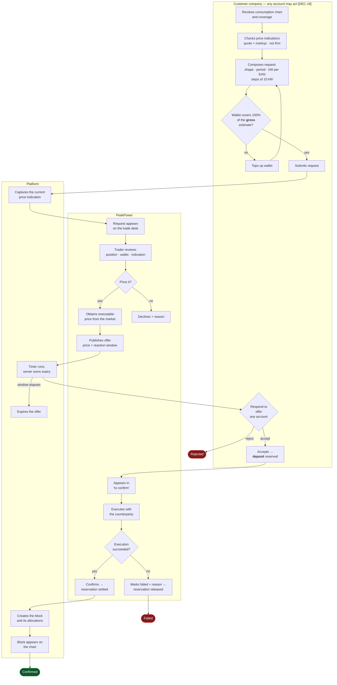
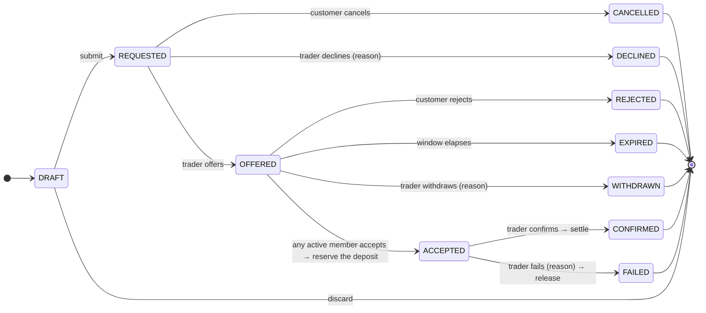
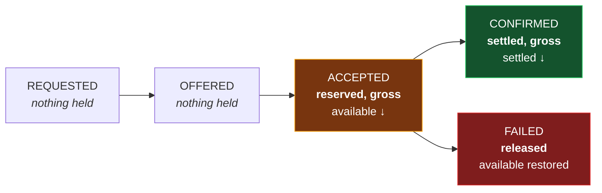
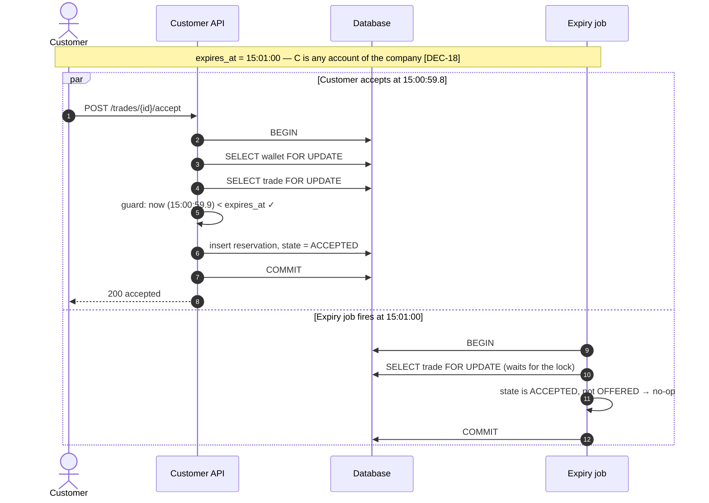

# Process — Trade Lifecycle

End-to-end, from a customer noticing an exposure to a confirmed position on the chart.

Feature spec: [F05](../10-features/F05-energy-block-trading.md).

> **Specified 2026-10-13 by [DEC-180] (10).** Volumes are in kW and kWh and prices in €/kWh, with at most 5 decimals; the grid is 10 kW. The amount reserved is made from the stored trade value, `round(value × (1 + VAT rate), 2)`, never from volume and price again. Every amount in the worked example below is unchanged; only the units of its volumes and prices moved. The per-EAN volumes in this page predate [DEC-167] (16) and stay as a structure.

> **What the 2026-08-19 round changed in this process.** ~~Four-eyes is no longer a value threshold but
> a **per-customer-company mode** **[DEC-71]**, so the branch at acceptance asks *which company is
> this*, not *how big is this*.~~ *(⚠ 2026-10-12, [DEC-179]: there is no four-eyes and no branch.)* The reservation and the wallet debit are **VAT-inclusive**
> **[DEC-78]** while the price stays quoted ex-VAT **[DEC-26]**. Volumes step in **10 kW**
> **[DEC-70]**, **[DEC-180]**. The sell path no longer checks holdings **[DEC-72]**. The wallet funds **trading
> only** — nothing in this lifecycle touches an invoice **[DEC-77]**. And an offer is notified to the
> **account that raised the request** ~~plus, under four-eyes, the **approving admin**~~ **[DEC-111]**,
> not to every active account. Two more things move at the edges of the process: the indication the
> customer starts from is a **quote plus a configurable markup**, default 2%, and is **never firm
> unless PeakPower says so** **[DEC-80]**; and a confirmed block **runs to the end of its delivery
> period even when the customer's contract ends first** **[DEC-82]**. 
> ⚠ **Reversed in part 2026-09-29 by [DEC-167]:** the indication the customer starts from is now the **raw quote**, not quote plus markup; the margin is in the firm offer price the trader types. It is still never firm unless PeakPower says so.

---

## 1. The whole process

~~The four-eyes branch **[DEC-33]** hangs off acceptance, not off the offer: the money is already reserved when it is entered, and the offer's own timer is still the only clock. [DEC-71] replaced the threshold with a boolean on the company.~~ ⚠ **Removed 2026-10-12 by [DEC-179]:** there is no branch. The boxes `A9`, `A10` and `C6` and the exits *declined by the second admin* and *expired after acceptance* are gone from the diagram; acceptance goes straight to *to confirm*, the reservation is held until confirm or fail, and the offer's own timer is the only clock, ending in *Expired* before acceptance.

Three boxes on the customer side do more than their labels admit.

| Box | What it actually does | Why |
| --- | --- | --- |
| `A2` | Shows the **marked-up** indication — the quote plus a configurable percentage, default 2%, held as reference data — labelled as an indication and **never firm unless PeakPower says so** **[DEC-80]** | The markup is the platform's only margin instrument now that surcharges have left it **[DEC-73]**. A raw quote here would give that margin away and imply a firmness the trader has not committed to **[F04](../10-features/F04-price-indications.md)** ⚠ **Reversed 2026-09-29 by [DEC-167]** — `A2` shows the **raw** indication (Prices page and request-panel estimate); the margin is in the offer price the trader types at `B3`-side pricing, not in the indication. |
| `A3` | Accepts volumes in steps of **10 kW**, minimum 10 kW per line **[DEC-70]**, **[DEC-180]**, reversing [DEC-32]'s 100 kW | Ten times finer. The per-EAN total now almost never lands on a whole clip of 1 000 kW, so the "PeakPower rounds on the market side" notice next to it is routine information rather than a warning **[F05-R07]** |
| `A4` | ⚠ **(17) [DEC-167]: compares available balance against the DEPOSIT (`depositPct` of the gross estimate), not 100% of it.** ~~Compares available balance against **100% of the gross estimate** — no buffer~~ **[DEC-41]**, grossed up at the 21% of **[DEC-64]** **[DEC-78]** | §4.1 works the figures. An ex-VAT check here clears a request whose own reservation it under-covers by 21%, and there is no buffer to absorb the difference |

For a `SELL` the same path runs with **no holdings check at all** **[DEC-72]** — the customer may sell
a block they do not hold. What that does to `A4` is the subject of §5.4.

## 2. State machine

~~Fourteen transitions over thirteen states since **[DEC-33]**; [DEC-71] kept the same fourteen tuples with `AWAITING_APPROVAL` entered on a per-company flag.~~ ⚠ **Amended 2026-10-12 by [DEC-179]:** **ten transitions over eleven states.** `AWAITING_APPROVAL` and `APPROVAL_REFUSED` leave the machine (they remain only as legacy values on rows that already carry them, and the diagram does not draw them). The authoritative, exhaustively testable tuple set lives in [Domain model §4.2](../20-architecture/03-domain-model.md); this diagram is a rendering of it and must not drift from it.

~~Three guards sat on the way into and out of `AWAITING_APPROVAL`: the accepting account is an active admin of the owning company (at a four-eyes company); the approving account is an active admin of the same company and is not `accepted_by`; and `now < expires_at`.~~ ⚠ **Two of the three are struck:** any active member may accept **[F05-R43]**, and nobody approves. What is left is `now < expires_at` **[DEC-13]**, checked on `accept` under the trade lock, with ids taken from the token, never from the request body **[DEC-17]**. The cost named here by [DEC-71] — *declining is no longer open to anyone, the acceptor's escape hatch is gone* — goes with the approval: there is nothing to decline, and a mistaken acceptance is as final as it was before [DEC-33].

## 3. Timing

```mermaid
gantt
    title Target timings for one trade
    dateFormat HH:mm
    axisFormat %H:%M

    section Customer
    Composes request      :a1, 14:15, 10m
    Reads offer, decides  :a2, 14:32, 12m

    section PeakPower
    Request in queue      :crit, b1, 14:25, 3m
    Trader prices it      :b2, 14:28, 4m
    Reaction window open  :active, b3, 14:32, 30m
    Executes on market    :b4, 14:44, 8m
    Confirms              :b5, 14:52, 3m
```

| Interval | Target | Alert |
| --- | --- | --- |
| Request → offer | median **< 30 min** | Request unpriced after 60 min ⚠ **Deferred 2026-09-29 by [DEC-167]** — the *request unpriced after 60 min* alert goes with **[F05-R39]** (slice 4); the desk mail (to every active back-office account with the desk-mail setting on, [DEC-168]) and the red *To confirm* age stand in. |
| Offer → customer response | within the window, default 30 min | Notification at T−5 min, to the **requesting account** ~~and, under four-eyes, the **approving admins**~~ **[DEC-111]** |
| ~~Acceptance → approval **[DEC-33]**, **[DEC-71]**~~ | ~~**inside the same window** — no separate clock~~ | ~~The **other admin accounts** are notified immediately, and again at T−5 min **[DEC-111]**~~ ⚠ **Removed 2026-10-12 by [DEC-179]** — no approval. |
| Acceptance → confirmation | median **< 30 min** | Escalation after 4 h **[F05-R39]** |

~~The middle row is the one that changes how the gantt above should be read for a large trade. The 30-minute reaction window has to accommodate two people, so a trader pricing a request for a four-eyes customer should quote a longer window [F05-R58].~~ ⚠ **Struck 2026-10-12 by [DEC-179]:** one person answers the offer, and the default window needs to fit one diary. **[DEC-111]** still narrows the offer notification to the requester: under [DEC-63] the offer landed in every active account's inbox, so any of them could rescue a window that was running out, and now only the requester is told. The mitigation is the portal rather than the mailbox: **[DEC-18]** still lets any account accept, and the offer is visible in-app to the whole company. Nobody else is *prompted*.

## 4. Money at each step

⚠ **Amended 2026-09-30 by [DEC-167] (17): a bought block is paid in two legs.** `TRADE_RESERVED`, `TRADE_SETTLED` and `TRADE_RESERVATION_RELEASED` below move the **deposit** (the company's percentage of the VAT-inclusive gross, frozen at accept). After `CONFIRMED` the **balance** — the rest of the gross — is owed until the day before delivery starts and is paid as `TRADE_BALANCE_PAID`, by the customer's *Pay balance* (`POST /trades/{id}/pay-balance`) or by the hourly automatic collection when the wallet covers it. Paying is not a state change (a `BALANCE_PAID` event, `CONFIRMED` to `CONFIRMED`); an unpaid balance after delivery starts is **overdue** — a derived flag, the trade stays `CONFIRMED` and nothing is cancelled.

Ledger entries produced: `TRADE_RESERVED` on acceptance, then either `TRADE_SETTLED`
(or `TRADE_PROCEEDS` for a sell) on confirmation, or `TRADE_RESERVATION_RELEASED` on failure.
~~on approval refusal, or on expiry after acceptance **[DEC-33]**, **[DEC-71]**~~ *(⚠ struck 2026-10-12, [DEC-179]: neither exists)*.

**Nothing in this lifecycle touches an invoice** **[DEC-77]**. The wallet funds **trading only**;
delivery — day-ahead, export and energiebelasting — is calculated monthly, pushed to the bookkeeping
program as a **draft invoice** **[DEC-88]** and paid to the bank. ⚠ **[AS-12] is reversed**, so the
`INVOICE_DEBIT` entry type is gone from the wallet and the four types named above are the only ones
this process can produce. The consequence for the diagram is exact: between `S3` and `S4` the
available balance can be moved by **another trade** and by nothing else, which is what ~~keeps the
"no second balance check on approval" rule safe~~ *(no approval since 2026-10-12, [DEC-179])* now that the reservation is the larger, gross figure.

⚠ The diagram's held amounts describe a **BUY**. A `SELL` holds nothing — `TRADE_PROCEEDS` carries no
reserved delta at all ([F06 §3](../10-features/F06-wallet-and-ledger.md)), it simply credits the
wallet on confirmation. That is unremarkable while a sell is covered by a position, and it is the
whole problem once **[DEC-72]** allows one that is not: see §5.4.

### 4.1 The money, worked

⚠ **[DEC-78]** — the amount reserved at acceptance and debited at confirmation is **VAT-inclusive**:
the stored trade value × `(1 + VAT rate)` at the 21% of **[DEC-64]** ⚠ **[DEC-180] (10): the value is `totalKwh × price` in €/kWh, frozen when the offer is made**. The price itself is still quoted,
offered and stored **ex-VAT** **[DEC-26]**. This is a **sizing rule for a wallet hold, not a tax
calculation** — it produces no VAT line anywhere, because the platform computes no VAT at all and the
bookkeeping program applies a rate per ledger account **[DEC-76]**.

One trade, TRD-1051 at *Vandersteen Koeling B.V.* — base shape, May 2026, three metering points:

| Step | Calculation | Result |
| --- | --- | --- |
| Volume per EAN **[DEC-70]** | `1370 + 860 + 520` kW, each a whole multiple of 10 kW | **2 750 kW** |
| Delivery intervals | May 2026: `31 × 96`. No DST change in May — the 2026 changes are 29 March and 25 October | **2 976 intervals** |
| Total volume | `2750 × 2976 × 0.25` | **2 046 000,0 kWh** |
| Indication shown at `A2` **[DEC-80]** | raw bid `0.06650` × `(1 + 0.02)` markup | **€ 0,06783/kWh** ⚠ **2026-09-29 [DEC-167]** — the customer now sees **€ 0,06650/kWh** (the raw bid); the markup example above is history. |
| Pre-submission estimate, ex VAT | `2046000 × 0.06783` | **€ 138.780,18** |
| Pre-submission check at `A4` **[DEC-41]**, **[DEC-78]** | `138780.18 × 1.21` — 100% of the **gross** estimate, no buffer. ⚠ **(17) [DEC-167]: at the default 20 % deposit the check is `167924.02 × 0.20`; the figures in this section are the gross, of which only the deposit is held at acceptance and the balance is paid later** | ~~**€ 167.924,02** must be available~~ **€ 33.584,80** (20 % deposit) must be available |
| Offer price, firm for the window, ex VAT **[DEC-26]** | quoted by the trader | **€ 0,06800/kWh** |
| Trade value, ex VAT **[AS-10]** | `2046000 × 0.06800` | **€ 139.128,00** |
| VAT at the **[DEC-64]** reference rate | `139128.00 × 0.21` | **€ 29.216,88** |
| **Gross incl. VAT** **[DEC-78]** — ⚠ (17) [DEC-167]: this is the stored gross; the amount *reserved at acceptance and debited unchanged at confirmation* is the **deposit** (20 % by default: **€ 33.668,98**), and the rest (€ 134.675,90) is the balance | `139128.00 × 1.21` | **€ 168.344,88** |

Reservation and debit are the **same stored number**, never two calculations, so a VAT-rate change
between acceptance and confirmation cannot open a gap and settlement cannot fall short. The gross-up
is rounded half-away-from-zero to 2 decimals once, at the point it becomes a wallet movement
([Energy block maths](../50-calculations/01-energy-block-maths.md) §4.1).

What the rule costs, in one line: a wallet holding **€ 150.000,00** passes an ex-VAT check on this
trade — € 139.128,00 — and then cannot cover its own reservation, short by **€ 18.344,88**.
**[DEC-41]** deliberately leaves no buffer to absorb that, which is precisely why the gross-up is not
optional.

⚠ The same arithmetic at the minimum **[DEC-70]**, **[DEC-180]**: `10 × 744 = 7 440 kWh`, `7440 × 0.06800 =
€ 505,92` ex VAT, and `505.92 × 1.21 = € 612,1632` → **€ 612,16** reserved. ~~At a customer with
four-eyes on, that trade needs the same second admin as the € 168.344,88 one **[DEC-71]**. There is
no small-trade exemption to fall back on, and at 0,01 MW steps the number of trades — and therefore
of approvals — is the thing that grows.~~ *(Struck 2026-10-12, [DEC-179].)*

**The reservation is created once, at acceptance.** ~~Approval moves no money at all — which is exactly why an approval can never fail for want of funds, and why the available balance cannot be spent underneath a pending approval.~~ ⚠ **Struck 2026-10-12 by [DEC-179]** (no approval). Note the consequence for `EXPIRED`: before **[DEC-33]** an expiry could never touch the wallet, because nothing was held before acceptance; ~~it could then, on a four-eyes customer's trades (the amount released was the gross one **[DEC-78]**)~~ since 2026-10-12 it again cannot: an accepted trade is `ACCEPTED`, and only a fail releases the reservation.

## 5. The dangerous moments

### 5.1 Acceptance at the expiry boundary

Row-level locking makes the race a queue. Whichever transaction takes the lock first decides; the
second observes the resulting state and does nothing. There is no window in which both succeed.

### 5.2 Confirmation

Wallet and trade change together, in one transaction, with a fixed lock order — **wallet first, then
trade** ([Database design](../20-architecture/04-database-design.md) §5). A partially applied
confirmation is not a state the system can reach.

⚠ **Lock order superseded 2026-09-29 by [DEC-167].** "Wallet first, then trade" is **replaced** by the one global order **admin roster → `customer.customer` → `trading.trade` → wallet**, never the wallet before the trade; every trade path (accept, ~~approve, refuse,~~ confirm, fail and the expiry sweep) takes a **subsequence** of it, and DEC-167 (7) records the path-by-path check against the withdrawal and reconciliation paths. ⚠ **2026-10-12, [DEC-179]:** the roster step leaves the trade paths. Confirmation therefore locks the trade, then the wallet.

### 5.3 ~~Approval at the expiry boundary — the sharpest edge in [DEC-71]~~

⚠ **Struck 2026-10-12 by [DEC-179].** This section was the sequence of an approve racing the expiry job, under one clock and one lock order, and the argument that a customer can neither bind PeakPower past the quoted window by approving late nor leave it holding a firm price while looking for a second signatory. With no approval there is no such race: the only boundary is §5.1, acceptance against expiry, and it is already a queue under the trade row lock. The heading keeps its number.

### 5.4 A sell with nothing behind it

⚠ **[DEC-34] reversed 2026-08-19 by [DEC-72]** — **short selling is permitted.** The sell path
performs **no validation against confirmed holdings** for the period. The case that motivates it is
real rather than speculative: a customer with solar production selling expected surplus.

The exposure this opens has to be stated plainly, because **none** of the three controls in this
document bites on it.

| Control | What it does for a BUY | What it does for a short SELL |
| --- | --- | --- |
| Pre-trade balance check **[DEC-41]** at `A4` | Blocks a request the wallet cannot cover, at 100% of the gross estimate **[DEC-78]** | **Nothing.** A sell credits the wallet; there is no spend to bound |
| Prepaid wallet, never negative **[AS-11]** | Caps the loss at the balance | **Nothing.** A short is a *promise to deliver*, not a spend, and the promise is not on the balance sheet the wallet keeps |
| Reservation at acceptance | Puts the money beyond reach until confirmation | Reserves nothing; `TRADE_PROCEEDS` is credited at confirmation |

So a customer whose panels underperform must buy back the shortfall — under **[DEC-23]** and
**[DEC-87]** the uncovered volume settles at the day-ahead price for the interval, raw, at whatever
that price turns out to be. Nothing in this lifecycle bounds how far that can move against them, and
the platform's only recourse is a wallet that may be empty.

⚠ **[OQ-94]** — *what collateral or exposure limit applies to a short position?* — is registered
against that gap and **blocks the sell path opening to customers**, even though the state machine in
§2 already permits the transition. Do not read §2 as authority to ship it.

### 5.5 The customer's contract ends before the block does

**[DEC-82]** — a block **runs to the end of its delivery period whatever happens to the contract**,
closing **[OQ-29]**. Offboarding does not unwind, transfer or mark-to-market anything, and the
contract end date is not an input to the block.

| Moment | What happens |
| --- | --- |
| Contract ends mid-period | The block is untouched. No state in §2 is entered and no reservation moves — the trade reached `CONFIRMED` long before |
| Metering data after that date | There is none. The connection is no longer read **[F02](../10-features/F02-metering-data-ingestion.md)** |
| Covered volume after that date | Zero, because covered volume is computed against net usage **[DEC-22]** and there is no usage |
| The block volume after that date | **All of it is surplus**, and surplus is sold at the day-ahead price for the interval **[DEC-23]**, raw, with no spread **[DEC-87]** |

The customer therefore keeps the full market risk on 100% of the remaining block. That is the answer
rather than an oversight: it is the over-covered month **[DEC-23]** already specifies, taken to its
limit. The lifecycle above needs no new branch for it, which is the whole reason the decision is
cheap.

## 6. Failure paths

| Path | Trigger | Money | Customer sees |
| --- | --- | --- | --- |
| Cancelled | Customer, before pricing | — | Cancelled |
| Declined | Trader will not price it | — | Declined + reason |
| Rejected | Customer says no | — | Rejected |
| Expired | Window elapsed **before acceptance** | — | Expired |
| ~~Expired~~ | ~~Window elapsed **while awaiting approval** **[DEC-33]**, **[DEC-71]**~~ | ~~**Released in full**, gross **[DEC-78]**~~ | ~~Expired — not approved in time~~ ⚠ **Removed 2026-10-12 by [DEC-179]** — no trade awaits approval. |
| Withdrawn | Trader pulls the offer | — | Withdrawn + reason |
| ~~Approval refused~~ | ~~A second account will not approve the acceptance **[DEC-33]** ⚠ **[DEC-71]**: **a different admin of the same company declines** it~~ | ~~**Released in full**, gross **[DEC-78]**~~ | ~~Not approved, by whom, optional reason~~ ⚠ **Removed 2026-10-12 by [DEC-179]** — there is no refusal; old trades keep a read-only *Not approved* label. |
| Failed | Execution failed after acceptance | **Released in full**, gross | Failed + reason |

Every PeakPower-initiated negative outcome carries a mandatory reason that the customer reads
**[F05-R38]**. ~~Approval refusal is customer-initiated, so its reason is optional, and the name and job title of the refusing account are always shown. [DEC-71] narrowed who may refuse to a different active admin.~~ ⚠ **Struck 2026-10-12 by [DEC-179]:** there is no approval refusal, and so no acceptor's escape hatch to discuss; the only customer-initiated negative outcomes are *rejected* and *cancelled* **[F05-R30]**.

## 7. Notifications

⚠ **Rewritten 2026-08-19 by [DEC-111]**, which reverses **[DEC-63]**, and by **[DEC-71]**. The
recipient column below is the post-decision truth; the rule it replaces — *every active account* — is
kept underneath the table.

| Moment | To | Channel |
| --- | --- | --- |
| Request submitted | Traders ⚠ **As built 2026-10-01 [DEC-168]:** *new trade request* is emailed to every active back-office account with the desk-mail setting on (admin or not), by the Worker up to ~15 s after the commit | In-app (real-time) + email |
| Offer published | ~~Every active account of the company~~ **The account that raised the request** ~~, plus — when the company has four-eyes on — **the admin accounts that would have to approve it**~~ **[DEC-111]** *(⚠ the requester only since 2026-10-12, [DEC-179])* | In-app (real-time) + email — **immediate** |
| 5 minutes remaining | The same set **[DEC-111]** | In-app + email |
| Offer expired | The same set **[DEC-111]**, traders | In-app + email |
| ~~**Approval needed** **[DEC-33]** **Approval requested** **[DEC-71]**~~ | ~~Every active account except the acceptor **The other admin accounts of the company** — every active admin except the one who accepted~~ | ~~In-app (real-time) + email — **immediate**, with the volume, the **gross** amount already held **[DEC-78]**, the acceptor's name and job title, and the time left~~ ⚠ **Removed 2026-10-12 by [DEC-179]** — no approval notification. |
| ~~5 minutes remaining, awaiting approval~~ | ~~The other admin accounts, traders~~ | ~~In-app + email~~ ⚠ **Removed 2026-10-12 by [DEC-179]** — no approval notification. |
| ~~Approved~~ | ~~Traders, the **acceptor** and the other admins ⚠ **As built 2026-10-01 [DEC-168]:** when the approval makes the trade ready to confirm, the *ready to confirm* email goes to the same desk recipients~~ | ~~In-app (real-time)~~ ⚠ **Removed 2026-10-12 by [DEC-179]** — no approval notification. |
| ~~Approval declined~~ | ~~The **acceptor** and the other admins, traders~~ | ~~In-app + email~~ ⚠ **Removed 2026-10-12 by [DEC-179]** — no approval notification. |
| Accepted | Traders ⚠ **As built 2026-10-01 [DEC-168]:** *accepted — ready to confirm* is emailed to every active back-office account with the desk-mail setting on | In-app (real-time) |
| Confirmed | The requester ~~, plus the admins where four-eyes applied~~ **[DEC-111]**. ⚠ **As built 2026-09-30 [DEC-167] (18):** the requester and the acceptor, from the employee host, **email only** | In-app + email (⚠ email only as built) |
| ⚠ **Balance paid** **[DEC-167] (18)** | The requester, the acceptor and, on the customer host, the payer | Email only |
| Failed | The requester ~~, plus the admins where four-eyes applied~~ **[DEC-111]** | In-app + email — **immediate** |
| Unconfirmed > 4 h | Traders | In-app escalation |

~~Offers go to everyone who could answer them, not only to the person who asked — see
[F11 §2](../10-features/F11-notifications.md) and **[DEC-63]**.~~
⚠ **Reversed 2026-08-19 by [DEC-111].** An offer goes to the **account that raised the request** ~~and,
under four-eyes, to the **approving admin**~~. Nobody else at the company is told, in-app or by email.
See [F11 §2](../10-features/F11-notifications.md).

⚠ **The cost, recorded because [DEC-63]'s rationale named exactly this:** a 30-minute offer can now
die because one person is in a meeting. **[DEC-18]** is untouched — *any* active account may still
accept — so the platform has deliberately narrowed who **knows** while leaving open who **may act**,
and those two sets are no longer the same. That gap is an accepted risk rather than an oversight. The
mitigation is the portal, not the mailbox: the offer is visible in-app to the whole company, and the
T−5 reminder still fires. The alternative, telling everyone, was rejected by the customer as noise.

~~Approval requests go to the other admins and not to the acceptor [DEC-33], [DEC-71]; the outcome rows go back to the acceptor.~~ ⚠ **Struck 2026-10-12 by [DEC-179]:** there are no approval requests.

Two rows carry an inference rather than a decision, and are flagged as such: **confirmed** and
**failed**. [DEC-111] speaks about *offer* notifications. A trade outcome belongs to the same request
and the only decision that ever gave it a wider audience was [DEC-63], which is reversed, so it
inherits the offer's audience. ⚠ **Confirm at the next session** (closed for **confirmed** on 2026-09-30: as built it goes to the requester and the acceptor, see the table) — the same flag
[F11 §2](../10-features/F11-notifications.md) carries.

## 8. Audit output

Every transition appends a `trade_event`. A complete history for a typical trade — TRD-1051, the one
costed in §4.1:

| # | Event | Actor | At | Recorded |
| --: | --- | --- | --- | --- |
| 1 | `SUBMITTED` | Customer account — **J. de Vries** *(Energy Manager)* | 14:25:03 | Volumes per EAN — 1 370 + 860 + 520 kW **[DEC-70]** — comment, and the captured indication **including its markup** **[DEC-80]** ⚠ **2026-09-29 [DEC-167]** — the captured indication is the raw price, its time and its source; no markup is captured. |
| 2 | `OFFERED` | Employee — M. Bakker | 14:31:20 | Price € 0,06800/kWh ex VAT, 30-minute window, `expires_at` 15:01:00 |
| 3 | `ACCEPTED` | Customer account — **M. Vandersteen** *(Finance Director)* | 14:44:12 | Gross amount reserved **€ 168.344,88** **[DEC-78]**, ex-VAT value € 139.128,00, reservation id |
| 4 | `CONFIRMED` | Employee — M. Bakker | 14:52:07 | External reference, block id, settled amount € 168.344,88 |

Events 1 and 3 are **two different people at the same company** — the normal split between spotting
an exposure and accepting the spend **[DEC-18]**. Each event stores the account id plus a snapshot of
the name and job title as at that moment, so the record still reads correctly years later even if
someone is promoted or leaves **[DEC-17]**.

### 8.1 ~~A trade at a customer with four-eyes on~~

⚠ **Struck 2026-10-12 by [DEC-179].** This worked example was the same trade at a company with the flag on: an `ACCEPTED` event that resulted in `AWAITING_APPROVAL`, an `APPROVED` event by a different admin, the five load-bearing fields an auditor read (initiator, approver, decision, initiated at, decided at), and the audit answer to *could one person have done this alone?* — a comparison of two account ids on two rows. There is no such trade any more. **What the timeline of a trade shows now:** `SUBMITTED`, `OFFERED`, `ACCEPTED` (state `ACCEPTED`, the deposit reserved), `CONFIRMED` — four events, each with the acting person's name and job title **[DEC-17]**. **What an old trade still shows:** its `APPROVED` or `APPROVAL_REFUSED` event, read-only. **What a trade that migration 39 moved shows:** an `ACCEPTED` event by the system actor, with the reason *four-eyes removed, DEC-179*, after the human `ACCEPTED` event that parked it.

Rendered as one timeline for both audiences, from the same rows **[F15](../10-features/F15-audit-and-observability.md)**.

## 9. Open questions

Post-2026-08-19 state for the questions this process turns on. The register of record is
[Open questions](../80-open-questions.md).

| Ref | Question | Status |
| --- | --- | --- |
| **[OQ-94]** | What collateral or exposure limit applies to a short position? | 🟠 **Open** — opened 2026-08-19 by **[DEC-72]**. The wallet is prepaid **[AS-11]** and a short is a promise to deliver rather than a spend, so neither §4's reservation nor **[DEC-41]**'s balance check bounds it. **Blocks the sell path opening to customers** — §5.4 |
| **[OQ-92]** | Are the hedge and the day-ahead delivery one invoice document or two? | 🟠 **Open**. Outside this lifecycle since **[DEC-77]** — no invoice is touched here — but it decides what the confirmed block eventually appears on, and under **[DEC-88]** how many drafts are pushed per customer per month |
| ~~[OQ-09]~~ | ~~Is four-eyes approval required above a value threshold?~~ | ✅ **Closed — [DEC-71]**, replacing **[DEC-33]**. There is no threshold. Four-eyes is a **per-customer-company mode**; a different **admin** of the same company approves or declines ⚠ **Four-eyes itself was removed 2026-10-12 by [DEC-179].** |
| ~~[OQ-85]~~ | ~~What is the four-eyes threshold amount, and is it one figure or per customer?~~ | ✅ **Closed — [DEC-71]**. No figure exists in euros or in megawatts, so the threshold reference table is **not built** and acceptance can no longer fail for want of a row in force ⚠ **Four-eyes itself was removed 2026-10-12 by [DEC-179].** |
| ~~[OQ-81]~~ | ~~When an offer arrives, is every account notified or only the requester?~~ | ✅ **Closed — [DEC-111]**, reversing **[DEC-63]**: the requesting account ~~, plus the approving admins under four-eyes~~. §7 records the cost |
| ~~[OQ-10]~~ | ~~May a customer sell a block they do not hold?~~ | ✅ **Closed — [DEC-72]**, reversing **[DEC-34]**: yes. The sell path performs no holdings check — and hands on **[OQ-94]** |
| ~~[OQ-08]~~ | ~~Minimum and increment for a requested volume?~~ | ✅ **Closed — [DEC-70]**, reversing **[DEC-32]**: **0,01 MW** minimum, 0,01 MW increment. Every volume in this document is a multiple of it |
| ~~[OQ-83]~~ | ~~Does the wallet debit settle the ex-VAT subtotal or the inclusive total?~~ | ✅ **Closed — [DEC-78]**: **inclusive**, for the reservation and the debit that settles it, grossed up at the **[DEC-64]** rate. **[AS-10]** is amended with it. §4.1 |
| ~~[OQ-19]~~ | ~~When a wallet cannot cover an invoice: full debit into negative, or partial settlement with a receivable?~~ | ✅ **Closed — [DEC-77]**, reversing **[AS-12]**: the wallet funds trading only and is never asked to cover an invoice, so the question disappears with the debit |
| ~~[OQ-29]~~ | ~~What happens to a block when the customer's contract ends mid-period?~~ | ✅ **Closed — [DEC-82]**: nothing unwinds. The block runs to the end of its delivery period and the whole volume settles at the day-ahead price — §5.5 |
| ~~[OQ-25]~~ | ~~Are indications shown raw, or with a PeakPower spread?~~ | ✅ **Closed — [DEC-80]**: never raw. Quote plus a configurable markup, default 2% and held as reference data, and never firm unless PeakPower says so — `A2` in §1 ⚠ **Reopened 2026-09-29 by [DEC-167]** — raw for the customer; licence question **[OQ-117]**. |
| ~~[OQ-42]~~ | ~~How many concurrent employees, and does the trade desk need real-time collaboration beyond a soft lock?~~ | ✅ **Closed — [DEC-50]**: a soft lock is enough. ⚠ **Amended 2026-08-19 by [DEC-91]** — the cross-customer same-period warning [DEC-50] added is **withdrawn**; two customers may request the same period. No branch in §1 depends on it |
